# CO2NNECT - Backend Ingestion Server

Serviço de ingestão e processamento de telemetria IoT para monitoramento de qualidade do ar (concentração de CO₂, temperatura e umidade relativa).

O servidor foi desenvolvido em **Java 21 Core** (sem frameworks), adotando comunicação orientada a eventos via protocolo **MQTT (Pub/Sub)**, com suporte a execução híbrida (**100% Local via Docker** ou **100% Nuvem via EMQX Cloud + Supabase**).

---

## 🏛️ Arquitetura do Sistema

```mermaid
flowchart LR
    A["ESP32 / Sensores<br/>(SCD30 / SCD41)"] -->|"MQTT (QoS 1)<br/>JSON Telemetria"| B["Broker MQTT<br/>(Mosquitto / EMQX Cloud)"]
    B -->|"Subscribe<br/>co2nect/+/telemetry"| C["co2nect-server<br/>(MqttSubscriber)"]
    C -->|"Validação das Regras<br/>de Negócio (CT1)"| D["SensorReadingService"]
    D -->|"JDBC Nativo (CT2)"| E["ReadingRepository"]
    E -->|"Insert Batch / PreparedStmt"| F["Banco de Dados<br/>(PostgreSQL / Supabase)"]
```



### Estrutura de Tópicos MQTT

| Tópico | QoS | Direção | Descrição |
| :--- | :---: | :---: | :--- |
| `co2nect/{deviceId}/telemetry` | 1 | Dispositivo ➔ Broker ➔ Server | Envio de telemetria (CO₂, temperatura, umidade). |
| `co2nect/{deviceId}/status` | 1 | Dispositivo ➔ Broker ➔ Server | Ciclo de vida do dispositivo (online: `1`, LWT offline: `0`). |
| `co2nect/{deviceId}/command` | 1 | Server ➔ Broker ➔ Dispositivo | Comandos de atuação (acionamento de alertas, buzzer, LED). |

---

## 🛠️ Tecnologias e Dependências

* **Linguagem:** Java 21 (LTS)
* **Gerenciador de Dependências:** Apache Maven
* **Cliente MQTT:** [Eclipse Paho Java Client](https://github.com/eclipse/paho.mqtt.java) (`org.eclipse.paho.client.mqttv3:1.2.5`)
* **Driver de Banco de Dados:** [PostgreSQL JDBC Driver](https://jdbc.postgresql.org/) (`org.postgresql:postgresql:42.7.13`)
* **Serialização/Desserialização JSON:** Google Gson (`com.google.code.gson:gson:2.10.1`)
* **Segurança e Criptografia:** TLS 1.2 / SSL nativo via `SSLSocketFactory` e certificados X.509
* **Infraestrutura Local:** Docker & Docker Compose (Eclipse Mosquitto 2.0 + PostgreSQL 16 Alpine)
* **Infraestrutura em Nuvem:** EMQX Cloud Serverless (Broker TLS 8883) + Supabase (PostgreSQL Session Pooler IPv4)

---

## ⚙️ Perfis de Execução

Ao iniciar, o servidor oferece um menu interativo com dois perfis operacionais:

1. **Perfil 1: Local (Docker)**
   * **Broker:** Mosquitto local (`tcp://localhost:1883`) sem autenticação;
   * **Banco:** PostgreSQL local (`jdbc:postgresql://localhost:5432/co2nect_db`).
2. **Perfil 2: Nuvem (Cloud)**
   * **Broker:** EMQX Cloud Serverless com criptografia **TLS/SSL (porta 8883)** e autenticação por usuário/senha;
   * **Banco:** Supabase PostgreSQL com conexão segura via **Session Pooler (IPv4)**.

---

## 🚀 Como Configurar e Executar

### 1. Pré-requisitos
* **Java Development Kit (JDK) 21** ou superior;
* **Maven 3.8+** instalado;
* **Docker & Docker Compose** (caso opte pela execução local).

---

### 2. Configuração do `.env` (Para Perfil Nuvem)
Copie o arquivo de exemplo `.env.exemple` para `.env`:

```bash
cp .env.exemple .env
```

Preencha com as suas credenciais:

```properties
# Configurações do Banco de Dados (Supabase)
DB_URL="jdbc:postgresql://aws-1-sa-east-1.pooler.supabase.com:5432/postgres?sslmode=require"
DB_USER="postgres.<project-ref>"
DB_PASSWORD="<sua-senha-do-banco>"

# Configurações do Broker MQTT (EMQX Cloud Serverless)
MQTT_BROKER_URL="ssl://<seu-cluster>.emqxsl.com:8883"
MQTT_USER="<usuario-mqtt>"
MQTT_PASSWORD="<senha-mqtt>"
MQTT_CA_CERT="certs/emqxsl-ca.crt"
```

> **Nota:** Certifique-se de salvar o arquivo do certificado CA raiz da Autoridade Certificadora em `certs/emqxsl-ca.crt`.

---

### 3. Execução em Modo Local (Docker)

Caso deseje rodar a infraestrutura localmente:

```bash
# Subir Mosquitto e PostgreSQL
docker compose up -d

# Verificar saúde dos contêineres
docker compose ps
```

---

### 4. Compilar e Rodar o Servidor

```bash
# Compilar o projeto
mvn clean compile

# Executar a aplicação principal
mvn exec:java -Dexec.mainClass="br.puc.campinas.co2nect.App"
```

No prompt do terminal, selecione:
```text
========================================
  CO2NNECT - Seleção de Ambiente
  1. Local (Docker: Mosquitto + Postgres)
  2. Nuvem (EMQX Cloud + Supabase)
========================================
Escolha o perfil [1 ou 2] (padrão: 2): 
```

---

## 📦 Formato da Mensagem de Telemetria (JSON)

Exemplo de payload publicado no tópico `co2nect/ESP32-SALA-101/telemetry`:

```json
{
  "deviceId": "ESP32-SALA-101",
  "co2": 720,
  "temperature": 24.5,
  "humidity": 52.0
}
```

* O backend valida se os valores estão dentro de faixas físicas aceitáveis;
* Registra log de alerta caso a concentração de CO₂ ultrapasse **1000 ppm**;
* Preenche automaticamente o campo `measuredAt` com o timestamp atual da JVM caso venha ausente;
* Grava os registros na tabela `sensor_reading` do PostgreSQL.

---

## 👥 Integrantes do Projeto

* Bruna Rafaela Garcia de Oliveira
* Giovana Budri Oliveira
* Gustavo Antunes
* Júlia Rodrigues da Rocha
* Vítor Bergantin Ribeiro
* William Walter de Oliveira
* Yuri Kauan