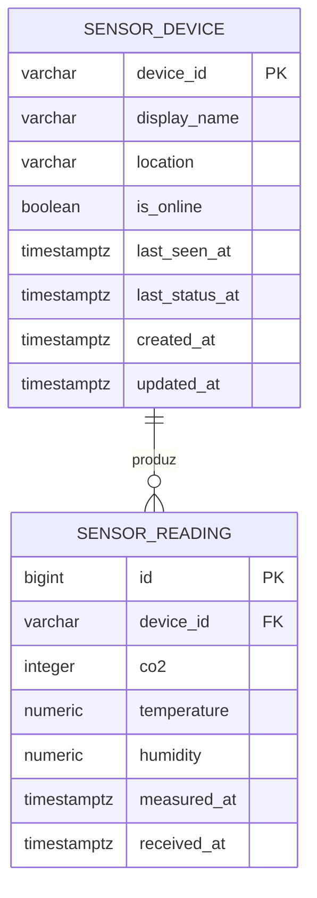

# Modelo entidade-relacionamento

## Justificativa das tabelas

- `sensor_device` separa a identidade e o estado do dispositivo das amostras. Isso evita repetir localização/nome em toda medição e permite consultar se o dispositivo está online.
- `sensor_reading` é uma tabela histórica append-only para os valores coletados. Não se atualiza a medição anterior quando chega uma nova.
- O índice composto `(device_id, measured_at DESC, id DESC)` atende a consultas de histórico por dispositivo e intervalo e ordenação mais recente primeiro.
- O índice em `received_at` ajuda a investigar atraso ou volume de ingestão.
- As médias do relatório são calculadas com `AVG` no PostgreSQL, não armazenadas como colunas, para não manter dados derivados inconsistentes.
