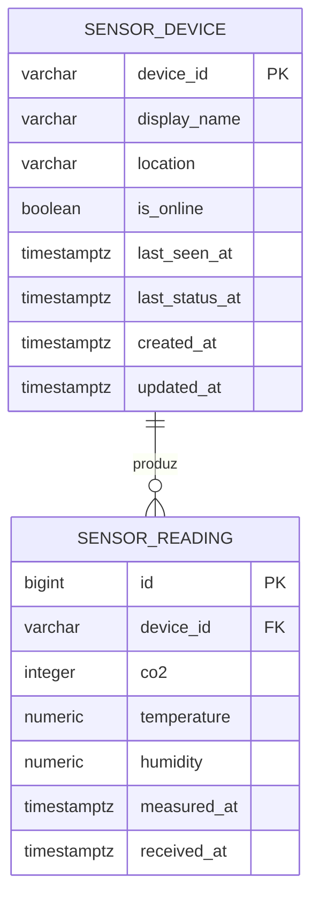

# Modelo entidade-relacionamento — CO₂NNECT

Fonte: `database/init/01-schema.sql` (schema versionado e montado pelo Compose local).

- `sensor_device`: cadastro de cada dispositivo e seu estado de conectividade mais recente.
- `sensor_reading`: histórico de amostras ambientais. Cada linha referencia exatamente um dispositivo.
- Cardinalidade: `sensor_device` 1:N `sensor_reading` (um dispositivo pode ter zero ou muitas leituras).
- Chave estrangeira: `sensor_reading.device_id` → `sensor_device.device_id`, `ON DELETE RESTRICT`.
- O diagrama representa o SQL versionado; a equivalência com o schema remoto do Supabase deve ser verificada separadamente.
